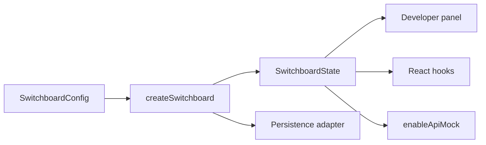

# Core Concepts

Switchboard centers on one **instance** created with `createSwitchboard(config)`. Everything else — React hooks, the panel, API mocks — reads and writes that instance.

## Instance

An instance owns:

| Area | Purpose |
| --- | --- |
| Features | Boolean flags + metadata (group, description, env defaults, override flag) |
| User | Simulated frontend context (`id`, `name`, `role`, `permissions`, custom keys) |
| Environment | Active environment name + optional presets |
| Scenarios | Named snapshots; one may be active |
| Response presets | Named JSON bodies for mocks |
| API mocks | Global rules; scenarios may replace them while active |

Create **one instance per app shell** (or per storybook story). Do not share mutable instances across unrelated apps.

## State snapshots

`getState()` returns an immutable snapshot. `subscribe(listener)` runs whenever meaningful state changes. React bindings use this via `useSyncExternalStore`.

## Overrides vs defaults

- A feature’s **resolved default** comes from `environments[active]` or the definition’s `default`
- `setFeature` stores an **override**
- `featureMeta[name].isOverridden` is `true` when the current value differs from the resolved default
- Activating a scenario applies that scenario’s feature/user/environment (and may set `activeScenarioId`)
- Manually changing a feature after activation typically **clears** `activeScenarioId` (the scenario is no longer an exact match)

## Persistence

| Option | Behavior |
| --- | --- |
| `'memory'` (default) | Survives within the page lifetime / adapter map |
| `'localStorage'` | Survives reloads in the browser |
| `false` | No persistence |
| Custom adapter | Implement `get` / `set` / `remove` |

Persisted payloads are versioned snapshots (`version: 1`).

## URL scenario param

By default, `?scenario=<id>` activates that scenario on startup. Set `urlScenarioParam: false` to disable, or pass another query key name.

## Soft failure

Invalid config throws `SwitchboardValidationError` at creation/update time. Persistence failures can be reported via `onError` without crashing the host app.

## Panel philosophy

The developer panel is **selection-only**:

- Show tabs only when data exists (no Features tab without flags, etc.)
- Buttons, radios, toggles, and dropdowns — no text fields
- Exception: custom JSON textarea when a mock response is set to **Other**

Configure structure in code; use the panel to activate and tweak selectable values.
